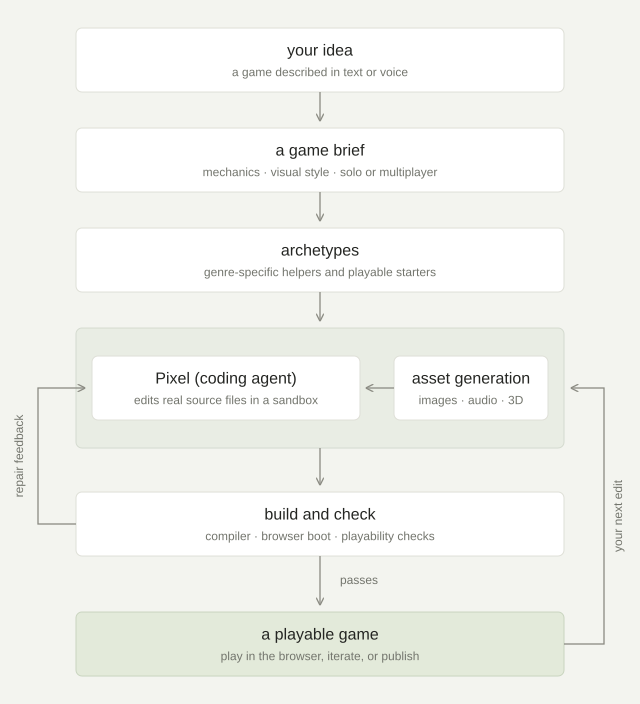

## intro

when i joined General Context (YC S26), we were still called Instaplay, building a platform that lets anybody turn an idea into a game. by the time of our seed round, we had over **120,000 monthly active users** and **40,000 published games**.

Instaplay is both a place to make games and a place to play them. you can browse a feed of community-made games, play in your browser, compete on leaderboards, and leave likes and comments. profiles collect people's published games, while friends, messages, and multiplayer rooms make it easy to play together.

## generation process

an initial planning step returned a JSON describing the game, and a coding agent then worked inside an isolated workspace to write the game's source and requested images, sound, or 3D objects as needed. these requests generated in parallel with the coding work.

in a redesign of our harness, we aimed to give the model as much freedom as possible. this included replacing Pi's agent loop with our own, removing almost all of the SDK and stripping the system prompt and instructions from 14.3k to 1.2k characters. we built a custom structure and game SDK that gives the agent ordinary html, css, and typescript.

<figure>
  <picture>
    <source media="(max-width: 520px)" srcset="/static/images/projects/instaplay-generation-mobile.svg?v=4" width="360" height="850">
    
  </picture>
</figure>

## contributions

- **the Bolt harness:**
  - redesign of Spark's job-per-operation pipeline around a continuous session and an in-house coding loop
  - compact, explicitly assembled prompts replace layers of ambient instructions; only relevant tools, libraries, and archetype guidance enter the agent's context
  - ordinary HTML, CSS, and TypeScript replace the custom game SDK contract, so Pixel works with familiar web APIs and owns the game's structure; a small bridge added at build time connects it to the platform
  - direct control over the coding loop makes tool scheduling, build feedback, repair, and telemetry part of the harness rather than an external agent process
  - graphics and physics libraries, playable archetype starters, and single-call sprite sheets give the agent reusable building blocks
  - median successful generation drops from **5m25s to 3m30s**
- **collaborative editing:**
  - friends-only co-editing with invitations, collaborator management, and permissions
  - shared edit queue lets collaborators line up, revise, or cancel requests while a change runs, with persistent ordering and access checks before execution.
- **live generation previews:**
  - a live view of the game inside its generation container
- **multiplayer playtesting and reliability:**
  - split-screen previews let creators test both seats of turn-based games before publishing
- **the editor experience:**
  - collapsible sidebars, chat and history controls, and waiting screens that let creators play featured games or edit another draft during generation
  - funnel analytics track the wait, leaderboard notifications and fixes improve music selection, messaging, and concurrent-generation chat
- **3D asset creation and editing:**
  - an object-authoring agent that renders and inspects its own work, plus parallel generation for comparing models
  - asset names, thumbnails, Pixel-based refinement, version history, and restore controls support editing
  - enabled publishing, discovering, forking, and reusing objects
